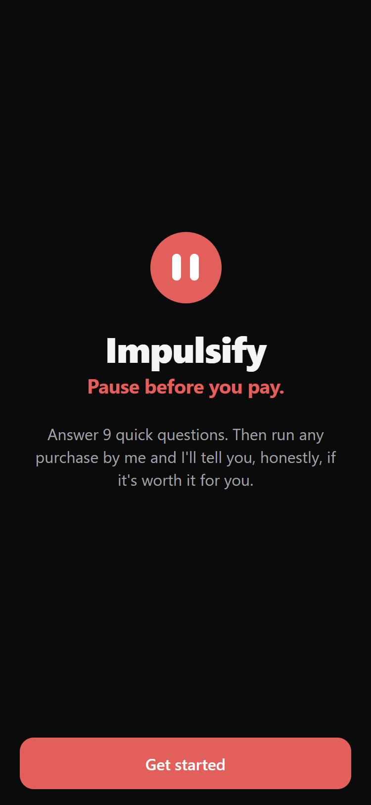
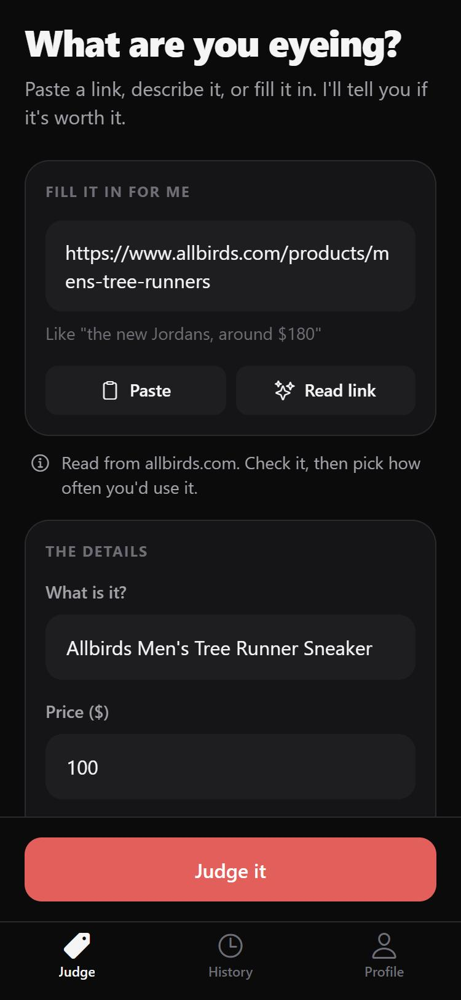
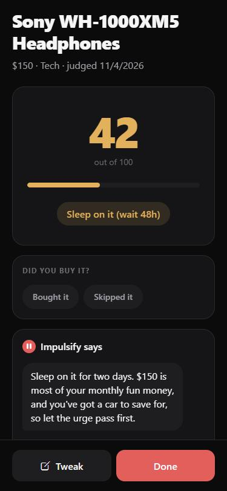
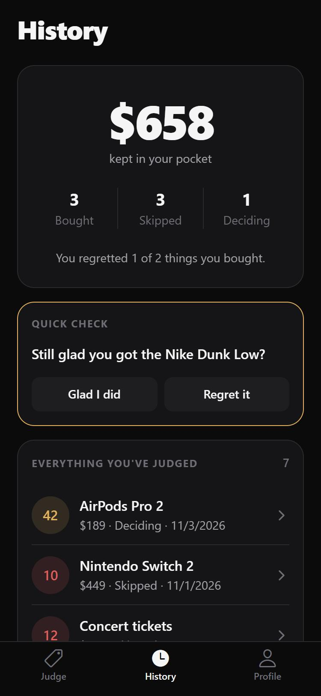
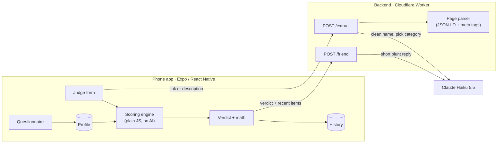

<p align="center">
  
</p>

<h1 align="center">Impulsify</h1>
<p align="center"><b>Pause before you pay.</b><br/>A blunt friend in your pocket that stops impulse purchases.</p>

<p align="center">
  
  
  
  
</p>

## What it does

1. **Learns you once.** A 9-question setup asks about your fun-money budget, what you're saving for, what you care about, and how often you regret purchases.
2. **Judges anything you want to buy.** Paste a product link, describe it ("the new Jordans, like $180"), or type it in. Impulsify reads the store page, fills in the details, and scores the purchase against *your* profile.
3. **Gives you a straight answer.** *Worth it for you*, *Sleep on it*, or *Don't, you're wasting money*, with the full math and a short, blunt take you can argue with.
4. **Remembers.** Every verdict is saved. Mark items Bought or Skipped, see how much you've kept, get a 48-hour "still want it?" reminder, and a week later: "still glad you bought it?"

## How it works



**The key design rule: the math decides, the AI talks.** The verdict always comes from a deterministic scoring engine. Claude only explains it, argues about it, and tidies up product names. It can admit you made a good point, but it can't change the score. That keeps every verdict explainable, testable, and the same every time.

### The scoring engine

[`src/scoring/scoreProduct.js`](src/scoring/scoreProduct.js) is a pure function: `scoreProduct(product, answers, now)` → `{ score, verdict, factors }`. Every number it uses lives in [`scoringConfig.js`](src/scoring/scoringConfig.js), so it can be tuned without touching the logic.

Every product starts at **50**. Each factor adds or subtracts points:

| Factor | Looks at | Points |
|---|---|---|
| Budget fit | price as % of your monthly fun money | ≤10%: +15 · ≤25%: +5 · ≤50%: −10 · ≤100%: −25 · over budget: −40 |
| Category | your priorities vs. what you're cutting back on | priority: +15 · cutting back: −20 |
| Cost per use | price ÷ uses in a year (daily 365 … rarely 3) | ≤$1: +15 · ≤$5: +5 · ≤$20: 0 · ≤$50: −10 · more: −20 |
| Saving goal | price as % of your goal, if you're saving | ≥20%: −20 · ≥5%: −10 |
| Late night | only if "late-night" is one of your triggers, 11pm–4am | −10 |

**Strictness** multiplies only the *negative* points: regret level 1 → ×0.8 up to 5 → ×1.3, plus 0.1 if you return things often and 0.1 if your income is irregular. People who regret more get judged harder.

The total is rounded and kept between 0 and 100: **65+** is *Worth it*, **40–64** is *Sleep on it*, **below 40** is *Don't*.

> **Example.** $200/month budget, Tech is a priority, saving $3,000 for a car, returns things often (×1.1). $150 headphones used daily:
> budget −25×1.1, priority +15, $0.41/use +15, 5% of goal −10×1.1 → 50 + 30 − 38.5 = **42 → Sleep on it**.

### Reading a link without making things up

[`backend/src/extract.js`](backend/src/extract.js) downloads the page and reads the structured product data stores embed for search engines (schema.org JSON-LD first, then Open Graph meta tags). That's plain code, no AI. Claude Haiku then only shortens the name and picks a category, using structured JSON output. **For links, the price only ever comes from the page.** The AI isn't allowed to supply one. If a store blocks the request (Amazon never shares prices with apps), the app highlights what's missing and asks you.

### Keeping the API key safe

The app never holds the Anthropic API key. It talks to a small Cloudflare Worker that stores the key as an encrypted secret, checks a shared app key, validates and size-limits every request, and only then calls Claude.

## Tests

```bash
npm test              # 15 tests: scoring engine + history stats
npm --prefix backend test   # 8 tests: the store-page extractor
```

Both use Node's built-in test runner, so there are no test libraries to install.

## Run it yourself

You need Node.js 22+, the **Expo Go** app on your phone, an [Anthropic API key](https://console.anthropic.com), and a free Cloudflare account.

```bash
npm install
npm --prefix backend install

# Backend: deploy the Worker and store its two secrets
cd backend
npx wrangler login
npx wrangler deploy
npx wrangler secret put ANTHROPIC_API_KEY
npx wrangler secret put APP_KEY      # any long random string
cd ..

# App: point it at your Worker (see .env.example), then start it
cp .env.example .env.local           # fill in EXPO_PUBLIC_API_URL and EXPO_PUBLIC_APP_KEY
npx expo start                        # scan the QR code with your iPhone camera
```

On Windows PowerShell, use `npx.cmd` / `npm.cmd` if scripts are blocked.

## Project layout

```
src/app/            screens (Expo Router: each file is a route)
  (tabs)/           Judge, History, Profile
  questionnaire.js  welcome + 9 questions
  verdict.js        score, bought/skipped, chat, math
src/scoring/        the scoring engine + its tests
src/history/        history stats, demo data
src/components/     design system: Screen, Card, buttons, chips, chat, score reveal
src/theme.js        every color, size, and text style
backend/src/        Cloudflare Worker: router, /friend, /extract, page parser, prompts
```

## Limits and next steps

- **Amazon prices** have to be typed in: Amazon doesn't expose them to apps, and scraping them would break its terms.
- **Share sheet** (share straight from Instagram or Amazon into the app) needs a paid Apple Developer account and a custom build. Pasting works today.
- **Data lives on your phone only.** Accounts and cloud sync would be the next big step.
- The Worker is protected by a shared key plus Anthropic spend limits, which is fine for a personal project. A public launch would need real user accounts and per-user rate limits.

## How this was built

Built in six rounds (questionnaire → scoring engine → AI chat → link reading → memory → polish), testing on an iPhone between each round, with [Claude Code](https://claude.com/claude-code) as a pair programmer.

## License

[MIT](LICENSE)
