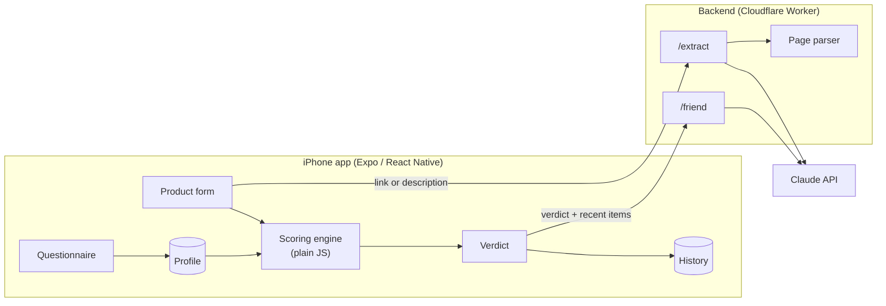

<p align="center">
  
</p>

<h1 align="center">Impulsify</h1>
<p align="center"><b>Pause before you pay.</b><br/>An iPhone app that tells you whether something you're about to buy is actually worth it.</p>

<p align="center">
  
  
  
  
</p>

<p align="center"><b><a href="https://impulsify.jjkar.workers.dev">Try it in your browser</a></b><br/><sub>On iPhone: open it in Safari, tap Share, then Add to Home Screen.</sub></p>

## About

I made Impulsify because most of my bad purchases were impulse buys I forgot about like a week later. The idea is simple: before you buy something, you run it by the app, and it gives you an honest answer based on your own budget and habits.

When you first open it, you answer a few quick questions: how much fun money you have each month, whether you're saving for something, which categories you care about, and how often you regret what you buy. After that, you can paste a product link, describe the item ("the new Jordans, like $180"), or type the details in yourself. The app scores it out of 100 and gives one of three answers: **worth it**, **sleep on it**, or **don't buy it**. You can see exactly how the score was calculated, and there's a short chat where the app explains its answer and you can argue back.

Every item you judge is saved. You can mark things as bought or skipped, see how much money you've kept, get a reminder 48 hours after a "sleep on it", and a week after buying something it asks whether you're still glad you got it. Those answers feed back into future scores.

## How it works



**The score itself never comes from AI.** It's calculated by a scoring engine written in plain JavaScript, so the same item always gets the same score and every point can be explained. The AI is only used for the chat and for cleaning up product names from links. It can agree you made a good point in the chat, but it can't change the score.

### Scoring

The engine is in [`src/scoring/scoreProduct.js`](src/scoring/scoreProduct.js), and all of its numbers are in [`scoringConfig.js`](src/scoring/scoringConfig.js) so they can be adjusted without touching the logic.

Every product starts at 50, then each factor adds or subtracts points:

| Factor | What it looks at | Points |
|---|---|---|
| Budget fit | price as a % of your monthly fun money | ≤10%: +15, ≤25%: +5, ≤50%: −10, ≤100%: −25, over: −40 |
| Category | whether it's something you care about or are cutting back on | priority: +15, cutting back: −20 |
| Cost per use | price divided by how many times you'd use it in a year | ≤$1: +15, ≤$5: +5, ≤$20: 0, ≤$50: −10, more: −20 |
| Saving goal | price as a % of what you're saving for | ≥20%: −20, ≥5%: −10 |
| Late night | only if you said late nights are a trigger (11pm to 4am) | −10 |
| Track record | how often you've regretted similar purchases (see below) | up to ±20 |

Negative points are multiplied by a strictness value based on how often you regret purchases, how often you return things, and how steady your income is. It ranges from 0.8 to about 1.5. The track record factor is left out of this, since it's already based on your regrets.

The final score is rounded and kept between 0 and 100. **65 or higher** means worth it, **40 to 64** means sleep on it, and **below 40** means don't buy it.

For example, with a $200 monthly budget, tech as a priority, a $3,000 car fund, and a strictness of 1.1, a pair of $150 headphones you'd use every day comes out like this:

```
start                         50
budget fit (75% of budget)   -25 x 1.1 = -27.5
category (priority)          +15
cost per use ($0.41)         +15
saving goal (5% of goal)     -10 x 1.1 = -11
                             ----
score                         41.5 -> 42, sleep on it
```

### Learning from past purchases

The app keeps track of which purchases you end up regretting and uses that to adjust future scores. This is in [`src/scoring/learn.js`](src/scoring/learn.js) and doesn't use AI either.

It starts from a guess based on how often you said you regret purchases (10% for "never" up to 60% for "constantly"). As you rate things you've bought, it moves toward your real regret rate using Bayesian smoothing, which stops one bad purchase from making it jump to 100%:

```
overall rate  = (regrets + 2 x guess) / (rated purchases + 2)
category rate = (regrets in category + 3 x overall rate) / (purchases in category + 3)
```

It does the same thing for price ranges (small, medium and big compared to your budget). For a new item, it averages the category rate and the price range rate, compares that to a typical regret rate of 30%, and turns the difference into points. The fewer similar purchases it has seen, the smaller the effect. It only starts once you've rated three purchases, and you can see what it has learned (or turn it off) on the profile screen.

### Reading product links

When you paste a link, the backend downloads the page and reads the product information that stores already include for search engines ([`backend/src/extract.js`](backend/src/extract.js)). The AI only shortens the product name and picks a category. **The price always comes from the page itself, never from the AI.** Some stores, including Amazon, don't share prices this way, so in that case the app asks you to type it in.

### API key

The app never contains the API key. It sends requests to a small Cloudflare Worker, which holds the key as a secret, checks that the request came from the app, limits the size of each request, and then calls the Claude API.

## Tests

```bash
npm test                    # scoring engine, learning, history stats (26 tests)
npm --prefix backend test   # product page parser (8 tests)
```

Both use Node's built-in test runner.

## Running it

You'll need Node.js 22 or newer, the Expo Go app on your phone, an Anthropic API key, and a free Cloudflare account.

```bash
npm install
npm --prefix backend install

# set up the backend
cd backend
npx wrangler login
npx wrangler deploy
npx wrangler secret put ANTHROPIC_API_KEY
npx wrangler secret put APP_KEY      # any long random string
cd ..

# point the app at your backend, then start it
cp .env.example .env.local           # fill in EXPO_PUBLIC_API_URL and EXPO_PUBLIC_APP_KEY
npx expo start                        # scan the QR code with your iPhone camera
```

If PowerShell blocks scripts on Windows, use `npx.cmd` and `npm.cmd` instead.

## Project structure

```
src/app/            screens (Expo Router, one file per screen)
  (tabs)/           Judge, History and Profile tabs
  questionnaire.js  welcome screen and setup questions
  verdict.js        score, bought/skipped, chat and the math
src/scoring/        scoring engine, learning and tests
src/history/        history stats and demo data
src/components/     shared UI components
src/theme.js        colors, spacing and text styles
backend/src/        Cloudflare Worker: chat, link reading and the page parser
```

## Web version

The same code also builds as a website. Expo exports it to `dist/`, and Cloudflare serves it (see `wrangler.jsonc` in the project root):

```bash
npx expo export --platform web
npx wrangler deploy
```

The web version works the same except for reminders and vibration, which need the phone app. To keep the AI costs under control, the backend limits each person to about 10 AI requests a minute.

## Known limitations

- **Amazon prices** have to be entered by hand.
- **Sharing** straight from another app (like Instagram or Amazon) into Impulsify would need a paid Apple Developer account, so for now you paste the link.
- **No syncing yet.** Everything is stored on your phone.
- **The backend** is fine for personal use, but a public release would need user accounts and per-user rate limits.

## License

[MIT](LICENSE)

<sub>Built with help from Claude Code.</sub>
